<!-- 輪廻眼 · paleta: preto #0B0B0F · roxo-lavanda #C9B6F2 · roxo médio #8E7CC3 · texto #E6E0F5 -->

  

  

  

## 輪廻眼 · About

  

## 六道 · Stack

  
  
  
  
  
  
  
  
  
  
  

  
  
  
  
  

  
  
  
  
  

  
  
  
  
  
  

  
  
  
  
  

## 天道 · Analytics

  

## 神羅天征 · Connect

  
  &nbsp;
  
  &nbsp;
  

  

